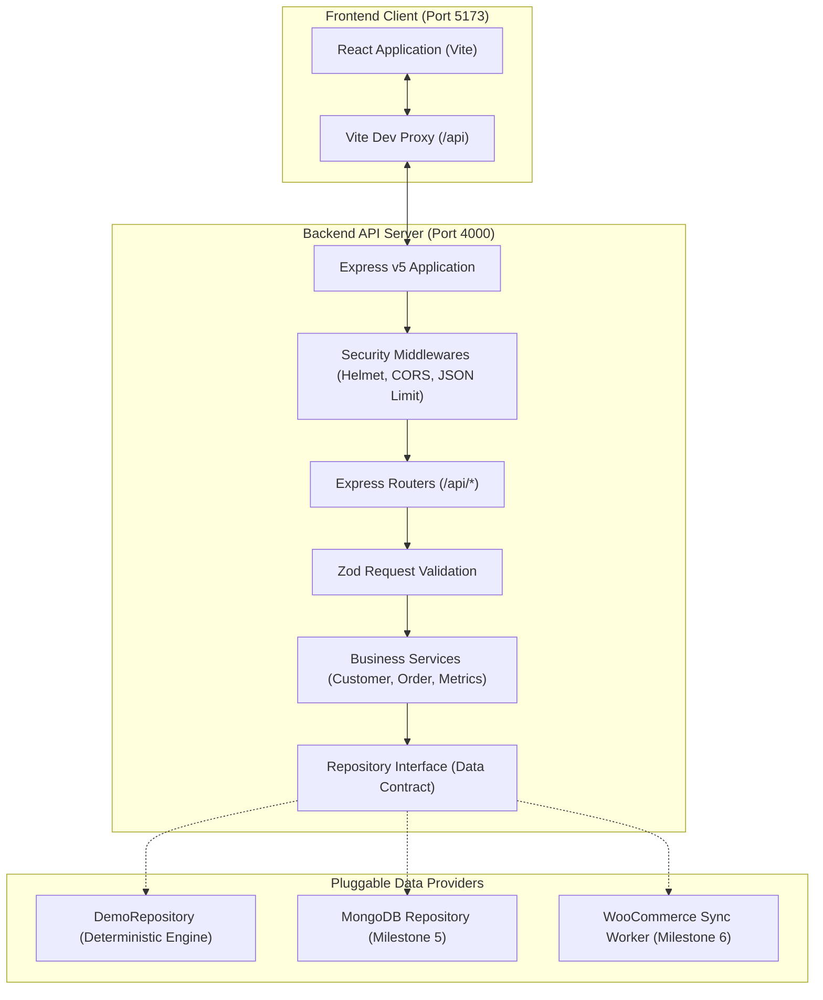

# CommercePilot System Architecture

This document describes the structural design, security perimeter, and execution lifecycle of CommercePilot.

---

## 1. High-Level Layer Diagram



---

## 2. Request Lifecycle

Every user action follows a strictly controlled request pipeline:

1. **Browser Dispatch:** The user loads the UI or triggers a refresh. React calls `apiClient('/api/customers?page=1')`.
2. **Development Proxy:** In development, Vite intercepts `/api/*` and proxies it to `http://localhost:4000`, bypassing cross-origin browser constraints while preserving cookie/header handling.
3. **Security Middleware:**
   - `helmet` applies defensive HTTP headers.
   - `cors` verifies `Origin: http://localhost:5173`.
   - `express.json({ limit: '100kb' })` guards against payload exhaustion.
   - Header `X-Data-Source: demo` is stamped on the response.
4. **Route Dispatch & Zod Validation:** The route middleware matches `GET /api/customers`. `validate({ query: paginationQuerySchema })` parses and coerces query parameters. If invalid, a standardized HTTP 400 is returned immediately.
5. **Service Layer Execution:** The route invokes `customerService.listCustomers(req.query)`. The service layer contains business logic (e.g., computing `totalPages`, aggregating KPIs, calculating deltas).
6. **Repository Abstraction:** The service calls `repository.listCustomers()`. It does not know or care whether data comes from an in-memory Mulberry32 PRNG, MongoDB, or an external API.
7. **Response Serialization:** The service returns domain objects, and the router serializes them into standardized JSON.
8. **Client Handling:** The React hook `useApi` receives the data, updates component state, and guards against unmounted state updates via `AbortController`.

---

## 3. Why the Repository Interface Exists

A major architectural goal of CommercePilot is decoupling the presentation and business logic from the underlying storage mechanism.

```javascript
// The unified repository contract
interface ICrmRepository {
  getMeta(): Promise<Meta>;
  listCustomers(params): Promise<{ data: Customer[]; total: number }>;
  getCustomerById(id: string): Promise<Customer | null>;
  listOrders(params): Promise<{ data: Order[]; total: number }>;
  getOrderById(id: string): Promise<Order | null>;
  getOrdersInRange(from: string, to: string): Promise<Order[]>;
  getAllCustomers(): Promise<Customer[]>;
}
```

### Benefits:
- **Zero Route Refactoring:** When Milestone 5 introduces MongoDB and Milestone 6 introduces WooCommerce, the REST API endpoints and React hooks do not change at all. Only the repository factory returns `MongoRepository` instead of `DemoRepository`.
- **Instant Demo Mode:** Store owners or evaluators can run CommercePilot in full demo mode without needing a live WooCommerce store or a cloud database connection.
- **Isolated Testing:** Services and endpoints are tested in vitest using deterministic in-memory repositories, completing hundreds of assertions in milliseconds without external network dependencies.

---

## 4. How MongoDB and WooCommerce Will Plug In

- **Milestone 5 (MongoDB):** A `MongoRepository` will implement `ICrmRepository`. It will use Mongoose models (`CustomerModel`, `OrderModel`) and MongoDB aggregation pipelines for instant KPI queries.
- **Milestone 6 (WooCommerce Sync):** A dedicated background sync worker will query the WooCommerce REST API (`/wp-json/wc/v3/orders` and `/wp-json/wc/v3/customers`) using server-side credentials (`WOOCOMMERCE_CONSUMER_KEY` and `WOOCOMMERCE_CONSUMER_SECRET`). It will normalize WooCommerce JSON into our Customer and Order contracts and upsert them into MongoDB.

---

## 5. Key Architecture & Security Decisions

1. **Native Async Error Handling in Express v5:** Express 5 natively handles rejected promises in route handlers without requiring third-party wrappers like `express-async-errors`.
2. **Server-Side Proxy Security:** The frontend never connects directly to WooCommerce. WooCommerce credentials reside exclusively in server `.env` files.
3. **Integer Cents Precision:** Floating-point numbers are converted to integer cents before addition or subtraction to eliminate precision errors.
4. **Abort Safety:** All frontend fetch requests are wrapped in an `AbortController` to guarantee clean unmounting.
